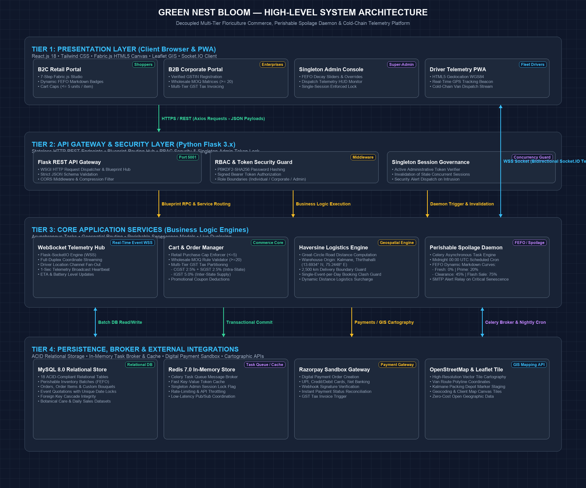
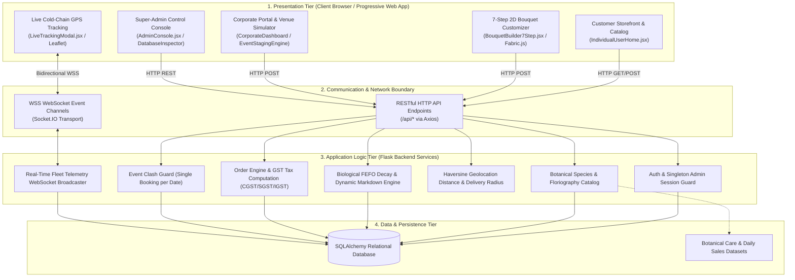
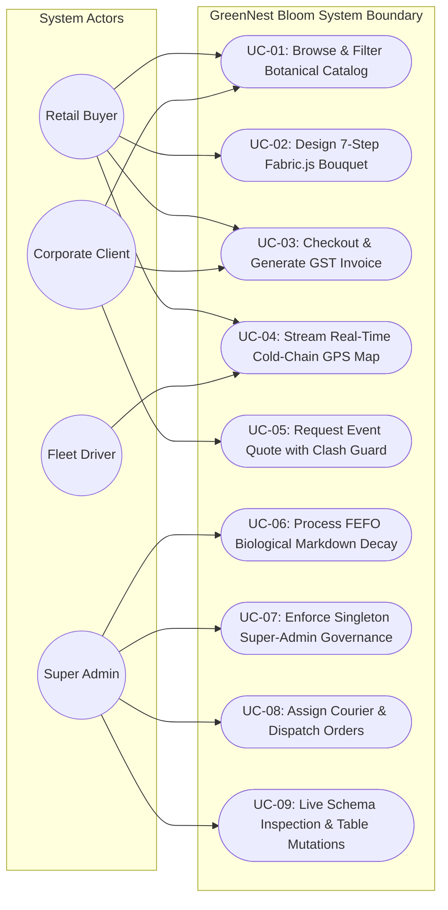
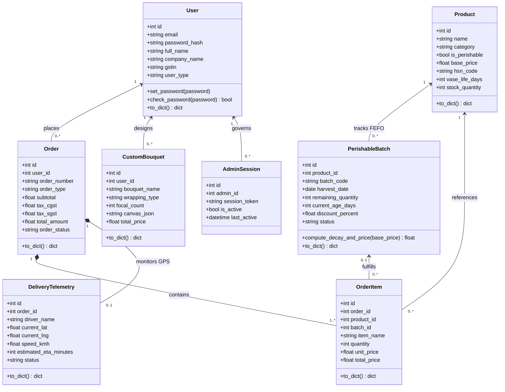
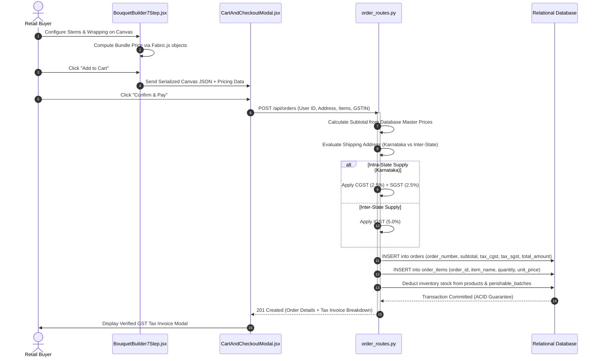
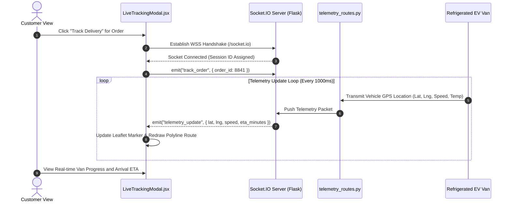
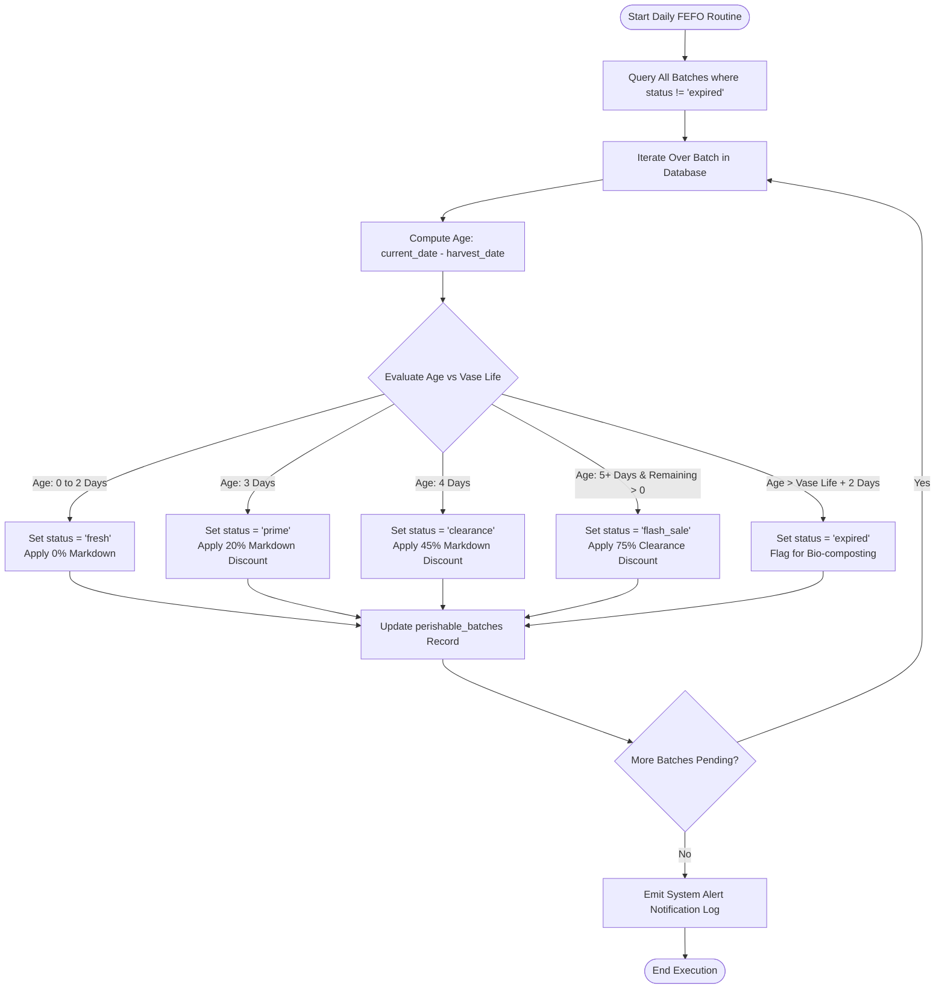

# A.J. INSTITUTE OF ENGINEERING & TECHNOLOGY, MANGALURU
## DEPARTMENT OF MASTER OF COMPUTER APPLICATIONS (MCA)

---

# SOFTWARE DESIGN SPECIFICATION (SDS)
### Applicable for Non-ML Projects

**Project Title:** GREEN NEST BLOOM: An Integrated B2C/B2B Floriculture Commerce, Perishable Spoilage Control, and Logistics Platform  
**Candidate Name:** Venisha Rizal Dsouza  
**USN:** 4JK25MC117  
**Degree / Semester:** Master of Computer Applications (MCA) — Semester 3  
**Internal Guide:** Ms. Ramya Prabhu  
**Academic Year:** 2026–2027  
**Document Identifier:** AJIET-MCA-2026-SDS-GNB-01  
**Version:** 1.0  
**Status:** Approved for Technical Review  

---

## TABLE OF CONTENTS

- [1. System Design](#1-system-design)
  - [1.1. Architectural Design](#11-architectural-design)
    - [1.1.1 & 1.1.2 High-level Architecture Diagram](#111--112-high-level-architecture-diagram)
    - [1.1.3 Subsystems / Components and Responsibilities](#113-subsystems--components-and-responsibilities)
    - [1.1.4 Data Flow and Component Communication](#114-data-flow-and-component-communication)
    - [1.1.5 Design Alternatives and Decisions](#115-design-alternatives-and-decisions)
- [2. Detailed Design](#2-detailed-design)
  - [2.1 Database Design](#21-database-design)
    - [2.1.1 Conceptual ER Diagram](#211-conceptual-er-diagram)
    - [2.1.2 Logical Schema and Relational Specifications](#212-logical-schema-and-relational-specifications)
  - [2.2. UML and Behavioral Design](#22-uml-and-behavioral-design)
    - [2.2.1 Use-Case Diagram and Descriptions](#221-use-case-diagram-and-descriptions)
    - [2.2.2 Class Diagram](#222-class-diagram)
    - [2.2.3 Sequence Diagrams for Critical Flows](#223-sequence-diagrams-for-critical-flows)
    - [2.2.4 Activity Diagram](#224-activity-diagram)
  - [2.3. User Interface Design](#23-user-interface-design)
- [3. References](#3-references)

---

# 1. System Design

## 1.1. Architectural Design

GreenNest Bloom is engineered following a decoupled, multi-tier **Client-Server Architecture** utilizing a **Single-Page Application (SPA)** front-end and a **RESTful Micro-Modular Backend** with real-time **WebSocket Event Duplexing**.

The system divides operational concerns into three core layers:
1. **Presentation Tier (Client Layer):** Single-page application built on React 18, Vite, Fabric.js (HTML5 Canvas 2D engine), Leaflet GIS mapping, and Socket.IO client.
2. **Application Logic Tier (Server Layer):** Python Flask 3.x WSGI service partitioned into Flask Blueprints, executing business logic engines (First-Expired, First-Out decay curves, Haversine geospatial calculations, GST taxation partitioning, and Singleton Admin session governance).
3. **Data Tier (Persistence Layer):** Relational persistence managed through SQLAlchemy ORM, enforcing strict ACID transactions, foreign key constraints, and relational integrity.

```
+=======================================================================================+
|                                    PRESENTATION TIER                                  |
|   React 18 SPA (Vite) | Fabric.js HTML5 Canvas | Leaflet GIS Maps | Socket.IO Client  |
+===========================================+===========================================+
                                            | HTTPS REST / WSS WebSocket Protocol
+===========================================v===========================================+
|                                   APPLICATION LOGIC TIER                              |
|   Flask Application Server (Port 5001) | WSGI Middleware | Blueprint Routing Hub       |
|   - Singleton Super-Admin Guard        - First-Expired, First-Out (FEFO) Decay Engine |
|   - Haversine Geospatial Radius Guard  - Multi-tier GST Tax Partitioning Engine        |
|   - Single-Event-per-Day Clash Guard   - Real-time Flask-SocketIO Fleet Dispatcher    |
+===========================================+===========================================+
                                            | SQLAlchemy ORM (Data Access Layer)
+===========================================v===========================================+
|                                      DATA TIER                                        |
|   Relational Database Engine (SQLite / PostgreSQL) | Raw Botanical Datasets (CSV)    |
+=======================================================================================+
```

---

### 1.1.1 & 1.1.2 High-Level Architecture Diagram



*Figure 1.1: Green Nest Bloom High-Level Multi-Tier Architecture Diagram*



---

### 1.1.3 Subsystems / Components and Responsibilities

The GreenNest Bloom platform is partitioned into discrete frontend components and backend subsystems:

#### A. Frontend Subsystems
1. **Catalog & Storefront Subsystem (`IndividualUserHome.jsx`, `CatalogSection.jsx`):** Responsible for botanical search queries, sunlight/watering filter chips, sentiment filtering, stock quantity displays, and cart mutations.
2. **Interactive 2D Customizer Studio (`BouquetBuilder7Step.jsx`):** Implements an object-oriented 7-step pipeline on an HTML5 Canvas using Fabric.js. Manages layer sorting, rotation transforms, stem collisions, greeting card inscriptions, and serialized JSON state exports.
3. **Corporate Wholesale Subsystem (`CorporateDashboard.jsx`):** Enforces Business-to-Business (B2B) Minimum Order Quantities (MOQ), verified Goods and Services Tax Identification Number (GSTIN) registration, and wholesale tiered discounting.
4. **Venue Staging & Quotation Simulator (`EventStagingEngine.jsx`):** Captures venue coordinates, evaluates warehouse delivery distances, renders visual modules (Arches, Centerpieces, Aisle runners), and computes estimated venue budgets.
5. **Cold-Chain Logistics Map (`LiveTrackingModal.jsx`):** Integrates Leaflet GIS to render animated marker locations, telemetry HUD metrics (speed, battery, temperature), and route polylines based on incoming WebSocket payloads.
6. **Administrative Console (`AdminConsole.jsx`, `DatabaseInspectorView.jsx`):** Provides super-administrators with FEFO decay override tools, single-session inspection, table row mutations, and test database resets.

#### B. Backend Subsystems
1. **Authentication & Governance Subsystem (`auth_routes.py`):** Enforces PBKDF2 with SHA-256 password hashing. Regulates singleton admin access by tracking `admin_sessions` and terminating earlier sessions upon new administrative logins.
2. **FEFO Biological Decay Engine (`batch_routes.py`):** Executes mathematical markdown depreciation curves for cut flowers based on harvest age relative to maximum vase-life:
   - Days 0 to 2: 0% discount (Fresh status)
   - Day 3: 20% discount (Prime status)
   - Day 4: 45% discount (Clearance status)
   - Day 5+: 75% discount (Flash Sale status before disposal)
3. **Commerce & Multi-tier Taxation Subsystem (`order_routes.py`):** Calculates product subtotals, validates promotional coupons, and computes statutory Indian GST partitions:
   - Intra-State (within Karnataka): 2.5% CGST + 2.5% SGST (Total 5.0%)
   - Inter-State: 5.0% Integrated GST (IGST)
4. **Haversine Geolocation Engine (`quote_routes.py`):** Computes great-circle road distances from the central packing hub at **Kalmane, Thirthahalli, Karnataka (13.6934 N, 75.2448 E)** to client venues, enforcing a maximum delivery radius of 2,500 km.
5. **Single-Event-per-Day Clash Guard Subsystem (`quote_routes.py`):** Prevents double-booking by querying `event_quotations` for existing bookings on the requested calendar date.
6. **Real-time Logistics Fleet Dispatcher (`telemetry_routes.py`, `app.py`):** Coordinates background daemon threads streaming simulated GPS coordinate updates over Socket.IO to connected tracking clients.

---

### 1.1.4 Data Flow and Component Communication

Data exchange across GreenNest Bloom employs two complementary communication channels:

```
[Client Browser] 
       |
       |--- 1. HTTP POST /api/orders (JSON payload: items, address, gstin) ---> [Flask API]
       |                                                                            |
       |                                                                       [SQLAlchemy]
       |                                                                            |
       |<-- 2. HTTP 201 Created (JSON payload: invoice_id, cgst, sgst) --------- [SQLite DB]
       |
       |=== 3. WSS Handshake: emit("track_order", { order_id: 101 }) =========> [Flask-SocketIO]
       |                                                                            ^
       |                                                                            | (GPS loop)
       |<== 4. WSS Broadcast: emit("telemetry_update", { lat, lng, speed, eta }) == [Fleet Courier]
```

1. **Transactional HTTP Request-Response Loop:**
   - The React client sends standard HTTP requests (`GET`, `POST`, `PUT`, `DELETE`) with Bearer tokens and JSON payloads.
   - Flask route handlers authenticate session tokens against the database, initiate SQLAlchemy transaction contexts, commit changes, and return HTTP status codes (`200 OK`, `201 Created`, `400 Bad Request`, `401 Unauthorized`).
2. **Real-Time Telemetry Streaming Loop:**
   - When viewing an active order, the client socket emits `track_order` specifying the target order ID.
   - The Flask-SocketIO event dispatcher binds the client to the order's telemetry stream.
   - Background timers query active `delivery_telemetry` coordinates and push location updates (`current_lat`, `current_lng`, `speed_kmh`, `estimated_eta_minutes`) to the client at 1-second intervals.

---

### 1.1.5 Design Alternatives and Decisions

| Decision Area | Selected Design | Rejected Alternative | Architectural Justification |
| :--- | :--- | :--- | :--- |
| **Backend Framework** | **Flask 3.x (Python)** | Django 5.x / FastAPI | Flask provides lightweight, modular routing via Blueprints without monolithic administrative overhead, allowing seamless integration with Flask-SocketIO. |
| **Canvas Customizer** | **Fabric.js 2D HTML5 Canvas** | Three.js / WebGL 3D | Fabric.js provides object-level manipulation, selection transforms, layer ordering, and JSON serialization with lower client memory consumption compared to full 3D rendering. |
| **Database Architecture** | **Relational (SQLAlchemy + SQLite/Postgres)** | MongoDB (NoSQL) | Financial transactions, GST tax calculations, and perishable inventory allocations require strict ACID guarantees and foreign-key referential integrity. |
| **Live Tracking Protocol** | **WebSockets (Socket.IO)** | HTTP Long-Polling | WebSockets eliminate HTTP header overhead on periodic GPS transmissions, reducing network latency during transit tracking. |
| **Frontend Framework** | **React 18 SPA via Vite** | Multi-Page App (Jinja2) | The 7-step canvas customizer, interactive Leaflet map, and cart drawers rely heavily on responsive client-side state without full-page reloads. |

---

# 2. Detailed Design

## 2.1 Database Design

The persistence tier is designed to handle retail commerce, B2B wholesale transactions, Fabric.js canvas states, biological inventory decay, and cold-chain vehicle telemetry.

### 2.1.1 Conceptual ER Diagram

```mermaid
flowchart TD
    classDef strongEntity fill:#1e293b,stroke:#38bdf8,stroke-width:2px,color:#f8fafc;
    classDef weakEntity fill:#0f172a,stroke:#f59e0b,stroke-width:2px,color:#f8fafc;
    classDef regularRel fill:#0f766e,stroke:#2dd4bf,stroke-width:1.5px,color:#ffffff;
    classDef identifyRel fill:#78350f,stroke:#fbbf24,stroke-width:2px,color:#ffffff;

    subgraph TIER1["Tier 1: Identity & Access Management"]
        USER["USER"]:::strongEntity
        R_ADMIN{"Login Sessions"}:::identifyRel
        ADMIN_SESSION[["ADMIN_SESSION"]]:::weakEntity
        R_WISH{"Saves"}:::identifyRel
        WISHLIST_ITEM[["WISHLIST_ITEM"]]:::weakEntity
        R_PUSH{"Registers"}:::identifyRel
        PUSH_TOKEN[["PUSH_TOKEN"]]:::weakEntity
        R_REMIND{"Schedules"}:::identifyRel
        OCCASION_REMINDER[["OCCASION_REMINDER"]]:::weakEntity

        USER ---|"1"| R_ADMIN ---|"0..N"| ADMIN_SESSION
        USER ---|"1"| R_WISH ---|"0..N"| WISHLIST_ITEM
        USER ---|"1"| R_PUSH ---|"0..N"| PUSH_TOKEN
        USER ---|"1"| R_REMIND ---|"0..N"| OCCASION_REMINDER
    end

    subgraph TIER2["Tier 2: Commerce, Catalog & Contracts"]
        ORDER["ORDER"]:::strongEntity
        PRODUCT["PRODUCT"]:::strongEntity
        CUSTOM_BOUQUET["CUSTOM_BOUQUET"]:::strongEntity
        SUBSCRIPTION["SUBSCRIPTION"]:::strongEntity
        EVENT_QUOTATION["EVENT_QUOTATION"]:::strongEntity
        COUPON["COUPON"]:::strongEntity
        SYSTEM_ALERT["SYSTEM_ALERT"]:::strongEntity
    end

    subgraph TIER3["Tier 3: Line Items, Batches & Fulfillment"]
        ORDER_ITEM[["ORDER_ITEM"]]:::weakEntity
        DELIVERY_TELEMETRY[["DELIVERY_TELEMETRY"]]:::weakEntity
        DELIVERY_PARTNER["DELIVERY_PARTNER"]:::strongEntity
        PERISHABLE_BATCH[["PERISHABLE_BATCH"]]:::weakEntity
        PRODUCT_REVIEW[["PRODUCT_REVIEW"]]:::weakEntity
        SUBSCRIPTION_FEEDBACK[["SUBSCRIPTION_FEEDBACK"]]:::weakEntity

        R_CONT{"Contains"}:::identifyRel
        R_GPS{"Streamed By GPS"}:::identifyRel
        R_DISP{"Assigned To"}:::regularRel
        R_FEFO{"Tracks Batches"}:::identifyRel
        R_REV{"Reviews"}:::identifyRel
        R_FEED{"Evaluates"}:::identifyRel

        ORDER ---|"1"| R_CONT ---|"1..N"| ORDER_ITEM
        ORDER ---|"1"| R_GPS ---|"0..1"| DELIVERY_TELEMETRY
        ORDER ---|"0..1"| R_DISP ---|"0..1"| DELIVERY_PARTNER
        PRODUCT ---|"1"| R_FEFO ---|"0..N"| PERISHABLE_BATCH
        PRODUCT ---|"1"| R_REV ---|"0..N"| PRODUCT_REVIEW
        SUBSCRIPTION ---|"1"| R_FEED ---|"0..N"| SUBSCRIPTION_FEEDBACK
    end

    %% Inter-Tier Relationships
    R_PLACES{"Places"}:::regularRel
    USER ---|"1"| R_PLACES ---|"0..N"| ORDER

    R_DESIGNS{"Designs"}:::regularRel
    USER ---|"1"| R_DESIGNS ---|"0..N"| CUSTOM_BOUQUET

    R_SUBS{"Subscribes"}:::regularRel
    USER ---|"1"| R_SUBS ---|"0..N"| SUBSCRIPTION

    R_QUOTES{"Requests"}:::regularRel
    USER ---|"1"| R_QUOTES ---|"0..N"| EVENT_QUOTATION

    R_STEMS{"Supplies Stems"}:::regularRel
    PRODUCT ---|"1..N"| R_STEMS ---|"0..N"| CUSTOM_BOUQUET

    R_REFS{"References"}:::regularRel
    PRODUCT ---|"0..1"| R_REFS ---|"0..N"| ORDER_ITEM

    R_ALLOC{"Allocates"}:::regularRel
    PERISHABLE_BATCH ---|"0..1"| R_ALLOC ---|"0..N"| ORDER_ITEM
```



> **Note on Diagram File:** A fully editable, native multi-tab Draw.io diagram containing all 18 entities and 200 attribute ovals is available in the project repository at [`GreenNest_Bloom_ERD.drawio`](file:///Users/rizal/GreenNest_Bloom/GreenNest_Bloom_ERD.drawio).

---

### 2.1.2 Logical Schema and Relational Specifications

#### 1. Table: `users` (Strong Entity)
Stores individual shoppers, corporate procurement accounts, and administrators.
- `id`: INTEGER, Primary Key, Auto Increment
- `email`: VARCHAR(120), Unique, Not Null, Index
- `password_hash`: VARCHAR(255), Not Null
- `full_name`: VARCHAR(100), Not Null
- `company_name`: VARCHAR(120), Nullable
- `gstin`: VARCHAR(15), Nullable (Required for B2B input tax credits)
- `user_type`: VARCHAR(20), Not Null, Default: `'individual'` (`individual`, `corporate`, `admin`)
- `phone`: VARCHAR(20), Nullable
- `address`: TEXT, Nullable
- `created_at`: DATETIME, Default: `datetime.utcnow`

#### 2. Table: `admin_sessions` (Weak Entity)
Enforces Singleton Super-Admin governance by invalidating previous login tokens.
- `id`: INTEGER, Primary Key, Auto Increment
- `admin_id`: INTEGER, Foreign Key references `users(id)`, Not Null
- `session_token`: VARCHAR(255), Unique, Not Null (Partial Key)
- `ip_address`: VARCHAR(45), Nullable
- `user_agent`: TEXT, Nullable
- `is_active`: BOOLEAN, Default: `True`
- `last_active`: DATETIME, Default: `datetime.utcnow`

#### 3. Table: `products` (Strong Entity)
Master catalog items including live plants, cut flowers, ceramic planters, and tools.
- `id`: INTEGER, Primary Key, Auto Increment
- `name`: VARCHAR(120), Not Null
- `category`: VARCHAR(50), Not Null (`cut_flower`, `potted_plant`, `planter`, `accessory`)
- `is_perishable`: BOOLEAN, Default: `False`
- `base_price`: FLOAT, Not Null
- `b2b_min_quantity`: INTEGER, Default: 1
- `b2b_discount_percent`: FLOAT, Default: 0.0
- `hsn_code`: VARCHAR(10), Default: `'0603'` (`0603` for Cut Flowers, `0602` for Live Plants)
- `botanical_name`: VARCHAR(120), Nullable
- `sunlight_requirement`: VARCHAR(50), Nullable
- `watering_frequency`: VARCHAR(50), Nullable
- `vase_life_days`: INTEGER, Default: 5
- `floriography_meaning`: TEXT, Nullable
- `image_url`: TEXT, Nullable
- `stock_quantity`: INTEGER, Default: 0

#### 4. Table: `perishable_batches` (Weak Entity)
Maintains FEFO tracking and biological price markdown curves for cut stems.
- `id`: INTEGER, Primary Key, Auto Increment
- `product_id`: INTEGER, Foreign Key references `products(id)`, Not Null
- `batch_code`: VARCHAR(50), Unique, Not Null (Partial Key)
- `harvest_date`: DATE, Not Null
- `initial_quantity`: INTEGER, Not Null
- `remaining_quantity`: INTEGER, Not Null
- `current_age_days`: INTEGER, Default: 0
- `vase_life_days`: INTEGER, Default: 5
- `discount_percent`: FLOAT, Default: 0.0
- `status`: VARCHAR(20), Default: `'fresh'` (`fresh`, `prime`, `clearance`, `expired`)

#### 5. Table: `orders` (Strong Entity)
Master commercial transaction record supporting retail, wholesale, and custom orders.
- `id`: INTEGER, Primary Key, Auto Increment
- `user_id`: INTEGER, Foreign Key references `users(id)`, Not Null
- `order_number`: VARCHAR(50), Unique, Not Null, Index
- `order_type`: VARCHAR(20), Not Null (`b2c_retail`, `b2b_wholesale`, `custom_bouquet`, `event_booking`)
- `subtotal`: FLOAT, Not Null
- `tax_cgst`: FLOAT, Default: 0.0
- `tax_sgst`: FLOAT, Default: 0.0
- `tax_igst`: FLOAT, Default: 0.0
- `total_amount`: FLOAT, Not Null
- `payment_method`: VARCHAR(50), Default: `'razorpay_test'`
- `payment_status`: VARCHAR(20), Default: `'paid'`
- `order_status`: VARCHAR(20), Default: `'processing'` (`processing`, `dispatched`, `in_transit`, `delivered`)
- `shipping_address`: TEXT, Not Null
- `created_at`: DATETIME, Default: `datetime.utcnow`

#### 6. Table: `order_items` (Weak Entity)
Line-item allocation with relationships to product master records and perishable batches.
- `id`: INTEGER, Primary Key, Auto Increment
- `order_id`: INTEGER, Foreign Key references `orders(id)`, Cascade On Delete, Not Null
- `product_id`: INTEGER, Foreign Key references `products(id)`, Nullable
- `batch_id`: INTEGER, Foreign Key references `perishable_batches(id)`, Nullable
- `item_name`: VARCHAR(120), Not Null (Partial Key)
- `quantity`: INTEGER, Not Null
- `unit_price`: FLOAT, Not Null
- `discount_percent`: FLOAT, Default: 0.0
- `total_price`: FLOAT, Not Null

#### 7. Table: `delivery_telemetry` (Weak Entity)
Maintains IoT telemetry metrics for live vehicle tracking.
- `id`: INTEGER, Primary Key, Auto Increment
- `order_id`: INTEGER, Foreign Key references `orders(id)`, Unique, Not Null
- `driver_name`: VARCHAR(100), Default: `'Ramesh Kumar'`
- `driver_phone`: VARCHAR(20), Default: `'+91-9876543210'`
- `vehicle_number`: VARCHAR(20), Default: `'KA-19-FL-4402'`
- `current_lat`: FLOAT, Not Null
- `current_lng`: FLOAT, Not Null
- `speed_kmh`: FLOAT, Default: 34.5
- `estimated_eta_minutes`: INTEGER, Default: 22
- `status`: VARCHAR(30), Default: `'en_route'` (`dispatched`, `en_route`, `delayed`, `delivered`)
- `updated_at`: DATETIME, Default: `datetime.utcnow`

#### 8. Table: `delivery_partners` (Strong Entity)
Fleet courier records for refrigerated EV delivery van operators.
- `id`: INTEGER, Primary Key, Auto Increment
- `full_name`: VARCHAR(100), Not Null
- `phone`: VARCHAR(20), Not Null
- `email`: VARCHAR(120), Nullable
- `vehicle_type`: VARCHAR(60), Default: `'Refrigerated EV Van'`
- `vehicle_number`: VARCHAR(30), Not Null
- `status`: VARCHAR(30), Default: `'available'` (`available`, `en_route`, `on_break`, `offline`)
- `current_lat`: FLOAT, Not Null
- `current_lng`: FLOAT, Not Null
- `speed_kmh`: FLOAT, Default: 0.0
- `battery_level`: INTEGER, Default: 90
- `rating`: FLOAT, Default: 4.9
- `completed_deliveries`: INTEGER, Default: 0
- `active_order_id`: INTEGER, Foreign Key references `orders(id)`, Nullable
- `shift_start`: VARCHAR(20), Default: `'08:00 AM'`
- `shift_end`: VARCHAR(20), Default: `'05:00 PM'`
- `zone`: VARCHAR(80), Default: `'Bengaluru Central Corridor'`
- `created_at`: DATETIME, Default: `datetime.utcnow`
- `updated_at`: DATETIME, Default: `datetime.utcnow`

#### 9. Table: `custom_bouquets` (Strong Entity)
Outputs generated by the 7-step Fabric.js canvas studio.
- `id`: INTEGER, Primary Key, Auto Increment
- `user_id`: INTEGER, Foreign Key references `users(id)`, Not Null
- `bouquet_name`: VARCHAR(100), Default: `'Bespoke Floral Creation'`
- `wrapping_type`: VARCHAR(50), Default: `'kraft_paper'`
- `focal_flower_id`: INTEGER, Foreign Key references `products(id)`, Nullable
- `focal_count`: INTEGER, Default: 5
- `filler_flower_id`: INTEGER, Foreign Key references `products(id)`, Nullable
- `filler_count`: INTEGER, Default: 3
- `foliage_id`: INTEGER, Foreign Key references `products(id)`, Nullable
- `foliage_count`: INTEGER, Default: 2
- `arrangement_style`: VARCHAR(50), Default: `'dome_round'`
- `fragrance_type`: VARCHAR(50), Default: `'rose_petal_mist'`
- `greeting_card_text`: TEXT, Nullable
- `canvas_json`: TEXT, Nullable
- `total_price`: FLOAT, Not Null
- `created_at`: DATETIME, Default: `datetime.utcnow`

#### 10. Table: `event_quotations` (Strong Entity)
B2B event bookings evaluated against the central nursery depot coordinates at Kalmane, Thirthahalli.
- `id`: INTEGER, Primary Key, Auto Increment
- `user_id`: INTEGER, Foreign Key references `users(id)`, Not Null
- `company_name`: VARCHAR(120), Nullable
- `event_type`: VARCHAR(50), Not Null (`wedding`, `gala`, `corporate_banquet`, `anniversary`)
- `event_date`: DATE, Not Null
- `guest_tier`: VARCHAR(50), Not Null (`intimate_50`, `medium_200`, `grand_500`)
- `venue_address`: TEXT, Not Null
- `venue_latitude`: FLOAT, Nullable
- `venue_longitude`: FLOAT, Nullable
- `distance_km`: FLOAT, Nullable
- `modules_json`: TEXT, Nullable
- `staged_image_url`: TEXT, Nullable
- `sentiment_prompt`: TEXT, Nullable
- `estimated_amount`: FLOAT, Not Null
- `admin_approved_amount`: FLOAT, Nullable
- `status`: VARCHAR(30), Default: `'pending'` (`pending`, `approved`, `declined`, `booked`)
- `created_at`: DATETIME, Default: `datetime.utcnow`

#### 11. Tables: `subscriptions` & `subscription_feedbacks`
- `subscriptions`: `id` (PK), `user_id` (FK), `tier`, `monthly_price`, `delivery_address`, `delivery_frequency`, `status`, `start_date`, `next_delivery_date`, `created_at`.
- `subscription_feedbacks`: `id` (PK), `subscription_id` (FK), `user_id` (FK), `delivery_cycle_month` (Partial Key), `overall_rating` (1-5), `freshness_rating`, `variety_rating`, `favorite_flowers`, `disliked_flowers`, `comments`, `created_at`.

#### 12. Peripheral Utility Tables
- `product_reviews`: `id` (PK), `product_id` (FK), `user_id` (FK), `reviewer_name`, `rating` (1-5), `review_title`, `review_text`, `photo_url`, `is_verified_purchase`, `helpful_votes`, `created_at`.
- `wishlist_items`: `id` (PK), `user_id` (FK), `product_id` (Partial Key), `created_at`. Composite Unique: `(user_id, product_id)`.
- `occasion_reminders`: `id` (PK), `user_id` (FK), `recipient_name`, `occasion_type`, `occasion_date`, `preferred_flower_type`, `notes`, `created_at`.
- `push_notification_tokens`: `id` (PK), `user_id` (FK), `token` (UK, Partial Key), `platform`, `device_info`, `is_active`, `created_at`, `updated_at`.
- `coupons`: `id` (PK), `code` (UK), `description`, `discount_type`, `discount_value`, `min_order_amount`, `max_discount_amount`, `is_active`, `valid_from`, `valid_until`, `usage_limit`, `times_used`, `created_at`.
- `system_alerts`: `id` (PK), `alert_type`, `recipient_email`, `subject`, `body`, `status`, `dispatched_at`.

---

## 2.2. UML and Behavioral Design

### 2.2.1 Use-Case Diagram and Descriptions



#### Use-Case Specifications

##### Use-Case UC-02: Design 7-Step Bespoke Bouquet
- **Primary Actor:** Retail Buyer
- **Pre-Conditions:** User is browsing the storefront; floral stem stocks are available.
- **Main Flow:**
  1. User enters the 7-Step Customizer studio view.
  2. Step 1: User selects wrapping material (Kraft paper, Jute wrap, Matte frosted sheet, Luxury satin box).
  3. Steps 2-4: User selects focal flowers (Dutch Red Roses, Lilies, Orchids), filler stems (Baby's Breath), and foliage greens (Eucalyptus, Ruscus).
  4. The Fabric.js engine calculates stem placements, renders layered canvas objects, and updates bundle pricing.
  5. Steps 5-7: User chooses arrangement styling (Dome, Cascading, Minimalist), selects fragrance mist, and inputs card message text.
  6. User submits design; the client packages serialized canvas JSON state with stem counts and appends it to the shopping cart.
- **Post-Conditions:** A custom bouquet record is persisted with an associated price in the active checkout session.

##### Use-Case UC-05: Request B2B Event Quotation with Clash Guard
- **Primary Actor:** Corporate Client / Event Planner
- **Pre-Conditions:** Client is authenticated with verified GSTIN identification.
- **Main Flow:**
  1. Client navigates to the Event Staging Portal and inputs event date, venue address, guest count tier, and styling theme.
  2. Client provides venue latitude and longitude coordinates.
  3. The server executes the **Haversine formula** from the central nursery hub at **Kalmane, Thirthahalli (13.6934 N, 75.2448 E)** to determine transit distance and calculate logistics surcharges.
  4. The system queries `event_quotations` to evaluate the **Single-Event-per-Day Clash Guard**. If a booking exists for that date, the date is locked and a conflict message is returned.
  5. If available, the quotation is generated with line-item estimates.
- **Post-Conditions:** Event quotation is stored with `pending` status awaiting administrative review.

---

### 2.2.2 Class Diagram



---

### 2.2.3 Sequence Diagrams for Critical Flows

#### Flow 1: 7-Step Bouquet Checkout with Multi-Tier GST Partitioning



#### Flow 2: Live GPS Cold-Chain Telemetry Streaming



---

### 2.2.4 Activity Diagram

#### Biological FEFO Inventory Aging & Price Decay Workflow



---

## 2.3. User Interface Design

The user interface follows modern responsive design standards, featuring a curated color palette (forest green, warm amber, and clean slate neutral tones), fluid typography, and immediate client-side feedback.

### Primary Screen Structure and Functional Breakdown

1. **Individual Customer Storefront (`IndividualUserHome.jsx`, `CatalogSection.jsx`):**
   - **Header & Hero Banner:** Displays brand identity, botanical seasonal offers, real-time search input, and filter chips (Cut Flowers, Potted Plants, Ceramic Planters, Care Accessories).
   - **Interactive Product Cards:** Displays botanical photography, scientific names, HSN codes, care badges (Sunlight / Water requirement tags), real-time stock counters, and one-tap "Add to Cart" and "Save to Wishlist" buttons.
   - **Perishable Discount Badges:** Highlights automatic dynamic price reductions (e.g., "Prime Batch: 20% Off" or "Flash Clearance: 45% Off") calculated by the FEFO inventory engine.

2. **Interactive 7-Step Bouquet Studio (`BouquetBuilder7Step.jsx`):**
   - **Step Indicator Pipeline:** Displays progressive workflow navigation (Wrapping Selection &rarr; Focal Flowers &rarr; Filler Stems &rarr; Foliage Greens &rarr; Arrangement Style &rarr; Fragrance Mist &rarr; Card Message).
   - **HTML5 Canvas Workspace:** A real-time visual canvas built with Fabric.js displaying layered stems, rotation transforms, drag-and-drop reordering, and live bundle price calculation.

3. **Corporate & B2B Wholesale Dashboard (`CorporateDashboard.jsx`):**
   - **Bulk Quotation Form:** Dedicated corporate ordering panel supporting wholesale minimum order quantities (MOQ), verified GSTIN input, and wholesale tiered pricing rules.
   - **Invoice Generation Drawer:** Provides tax breakdown views distinguishing between Central GST (CGST 2.5%) and State GST (SGST 2.5%) for Intra-State supply, and Integrated GST (IGST 5.0%) for Inter-State shipments.

4. **Event Staging & Venue Simulator (`EventStagingEngine.jsx`):**
   - **Venue Setup Form:** Captures venue specifications, seating capacity tiers (Intimate: 50, Medium: 200, Grand: 500+ guests), and event themes.
   - **Haversine Distance & Logistics Surcharge Engine:** Displays automated road distance calculations and logistics fees from the warehouse coordinate origin at Kalmane, Thirthahalli.
   - **Single-Event-per-Day Clash Guard:** Displays available event dates while disabling and flagging dates already booked for weddings or banquets.

5. **Cold-Chain Live GPS Tracking Modal (`LiveTrackingModal.jsx`):**
   - **Interactive Map:** Leaflet GIS map with custom vehicle pins marking the refrigerated EV van's coordinates, customer destination pins, and transit polyline routes.
   - **Driver & Telemetry HUD:** Displays driver contact info, vehicle registration number, live speed (`km/h`), battery percentage (`%`), and estimated arrival time countdown (`minutes`).

6. **Administrative Console & Database Inspector (`AdminConsole.jsx`, `DatabaseInspectorView.jsx`):**
   - **Batch Expiration Table:** Interface for warehouse managers to view harvest dates, calculate decay levels, and review FEFO markdown actions.
   - **Live Schema Inspector:** An administrative interface allowing staff to view database tables, inspect raw rows, and execute database resets during testing.

---

# 3. References

1. **Flask Core Documentation (v3.0.x):** Pallets Projects. *Flask Application Structure, Blueprints, and Application Factory Patterns.* Available: `https://flask.palletsprojects.com/`
2. **SQLAlchemy ORM Documentation (v2.0.x):** Bayer, M. *Object Relational Tutorial and Declarative Mapping.* Available: `https://docs.sqlalchemy.org/`
3. **React Core Documentation:** Meta Platforms, Inc. *Component Lifecycle, Hooks (`useState`, `useEffect`), and Single-Page Architecture.* Available: `https://react.dev/`
4. **Fabric.js HTML5 Canvas Engine:** Kasyanov, J. *Object-Oriented HTML5 Canvas Programming and Serialization.* Available: `http://fabricjs.com/`
5. **Socket.IO Real-Time Engine:** Raimondo, G. *Bi-directional Event-based Communication over WebSockets.* Available: `https://socket.io/`
6. **Leaflet Open-Source Mapping Library:** Agafonkin, V. *Mobile-Friendly Interactive Maps and GeoJSON Projections.* Available: `https://leafletjs.com/`
7. **IEEE Standard 1016-2009:** IEEE Computer Society. *IEEE Standard for Information Technology — Systems Design — Software Design Descriptions.*
8. **Central Board of Indirect Taxes and Customs (CBIC):** Government of India. *Goods and Services Tax (GST) Tariff Classification under HSN Chapters 0602 and 0603.* Available: `https://cbic.gov.in/`
9. **Haversine Formula for Great-Circle Distances:** Sinnott, R. W. *Virtues of the Haversine.* Sky and Telescope, vol. 68, no. 2, 1984.
